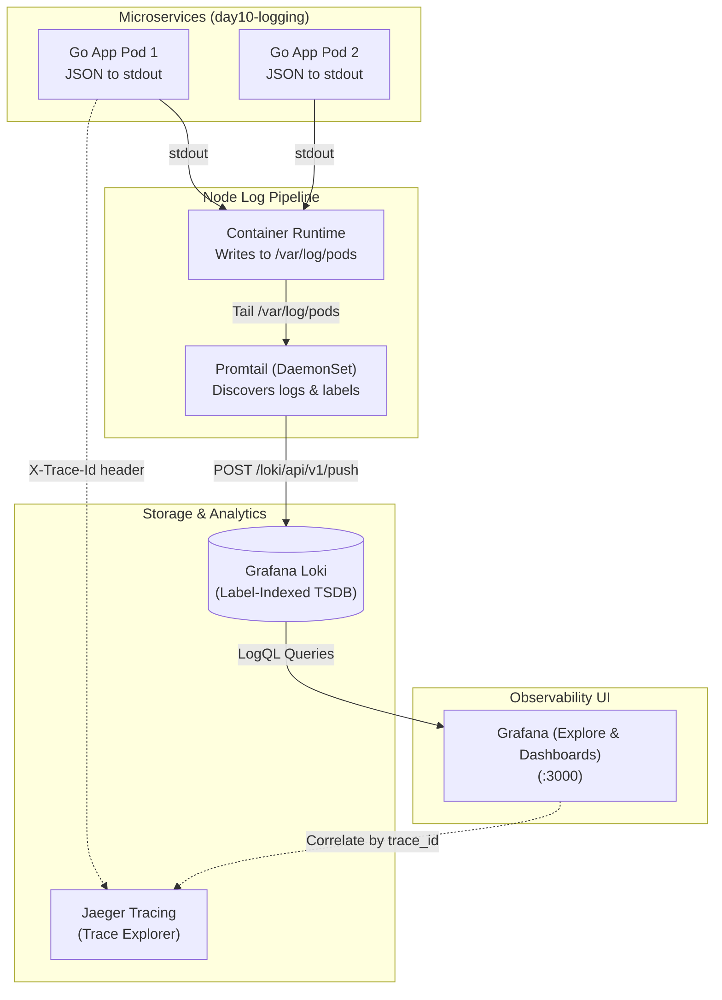

# Day 10: Observability II - Logging & Tracing

## 🎯 Goal
Understand **why** issues occur in production. Move beyond `kubectl logs` by building a centralized, cloud-native logging pipeline using **Loki, Promtail, and Grafana** (the PLG stack). Implement **Structured JSON Logging** with Go's standard `log/slog`, query logs across distributed pods with **LogQL**, and learn how **Distributed Tracing** correlates logs, metrics, and traces using a unified `trace_id`.

---

## 🏗️ Architecture: Centralized Logging & Distributed Tracing



---

## 📋 Prerequisites & Image Build

### 1. Build the Go Logging App
```powershell
cd day10/app
docker build -t k8s-day10:v1 .
```

### 2. Import into Cluster (If using k3d / k3s)
```powershell
k3d image import k8s-day10:v1 -c k8s-class
```

### 3. Create the Dedicated Namespace
```powershell
cd ../k8s
kubectl apply -f 01-namespace.yaml
```

---

## 🧪 Step-by-Step Hands-on Labs

### Lab 1: Deploy Loki, Promtail, Grafana & The Application

We deploy the complete logging stack in one coordinated step:
```powershell
kubectl apply -f 02-loki-standalone.yaml
kubectl apply -f 03-promtail-daemonset.yaml
kubectl apply -f 04-go-app-deployment.yaml
kubectl apply -f 05-go-app-service.yaml
kubectl apply -f 06-grafana-logging.yaml
kubectl apply -f 08-jaeger-tracing.yaml
```

Verify all components are running:
```powershell
kubectl get pods -n day10-logging
```

**Expected Components:**
* `loki`: Ingests and stores logs indexed by labels.
* `promtail`: DaemonSet that tails `/var/log/pods` and pushes to Loki.
* `go-logging-app`: 2 replicas emitting structured JSON logs.
* `grafana-logging`: Visualization UI pre-configured with Loki.
* `jaeger`: Distributed tracing UI.

---

### Lab 2: Inspect Structured JSON Logs via `kubectl logs`

First, observe how our Go application formats logs natively:
```powershell
kubectl logs -n day10-logging -l app=go-logging-app --tail=10
```

Notice how every entry is formatted as a single-line JSON document:
```json
{
  "time": "2026-11-18T14:30:12.456Z",
  "level": "INFO",
  "msg": "HTTP request completed",
  "trace_id": "a98f12cd8374be21f3014a09",
  "span_id": "c104ab32",
  "method": "GET",
  "path": "/healthz",
  "status": 200,
  "duration_ms": 1,
  "client_ip": "10.42.0.1:48212"
}
```
> 💡 **Why JSON?** Text logs like `"Error: connection refused at 14:00"` require brittle regex to parse. Structured JSON allows tools like Loki and Elasticsearch to parse fields (`status`, `trace_id`, `duration_ms`) instantly.

---

### Lab 3: Start the Traffic Generator

Start the simulated traffic pod, which continuously generates a blend of normal checkouts, intermittent database failures, and slow requests:
```powershell
kubectl apply -f 07-traffic-generator.yaml
```

Verify traffic is streaming:
```powershell
kubectl logs -f deployment/logging-traffic-generator -n day10-logging
```

---

### Lab 4: Querying Logs with LogQL in Grafana

#### 1. Open Grafana
Forward Grafana to port 3000:
```powershell
kubectl port-forward svc/grafana-logging 3000:3000 -n day10-logging
```
Open **http://localhost:3000** (Username: `admin` | Password: `admin`).

#### 2. Open the Explore View
Click on the **Explore (Compass icon)** on the left navigation bar.
Select **Loki** as the data source from the dropdown at the top.

#### 3. LogQL Mastery: Run These Queries

1. **Basic Stream Selector (All logs for our application):**
   ```logql
   {app="go-logging-app"}
   ```

2. **Search for "error" across all pods (Case-insensitive):**
   ```logql
   {app="go-logging-app"} |= "error"
   ```

3. **Exclude noise (Ignore health checks):**
   ```logql
   {app="go-logging-app"} != "/healthz"
   ```

4. **Regex Filter (Match critical or failure):**
   ```logql
   {app="go-logging-app"} |~ "(?i)critical|failure"
   ```

5. **JSON Parser (Extract JSON keys into queryable fields):**
   ```logql
   {app="go-logging-app"} | json
   ```
   *Notice how Grafana automatically extracts `level`, `status`, `trace_id`, and `duration_ms` into structured labels!*

6. **Filter on Parsed JSON Fields (Find all HTTP 5xx errors):**
   ```logql
   {app="go-logging-app"} | json | status >= 500
   ```

7. **Find Slow Requests (Queries taking more than 300ms):**
   ```logql
   {app="go-logging-app"} | json | duration_ms > 300
   ```

8. **Metric Query: Error Rate Per Minute (Graphing logs!):**
   ```logql
   sum(rate({app="go-logging-app"} |= "error" [1m]))
   ```

---

### Lab 5: Distributed Tracing & Correlating by `trace_id`

When an incident occurs in production, logs alone tell you *what* happened, but distributed tracing tells you *where in the call chain* it happened.

#### 1. Copy a `trace_id` from an Error Log in Grafana
Look at any log entry returned by:
```logql
{app="go-logging-app"} | json | level="ERROR"
```
Copy the `trace_id` (e.g., `4e2c9f1a08b5d3e789c0a1b2c3d4e5f6`).

> 💡 **One-Click Trace Correlation**: Because we pre-configured `derivedFields` in `06-grafana-logging.yaml`, expanding any log line in Grafana displays an interactive **TraceID** button that opens the Jaeger trace directly!

#### 2. Query All Logs for That Single User Journey:
Run this query in Grafana:
```logql
{app="go-logging-app"} |= "4e2c9f1a08b5d3e789c0a1b2c3d4e5f6"
```
You will see every individual step executed for that request (inventory check -> payment attempt -> database timeout -> HTTP response), even if requests hopped across multiple pods!

#### 3. Open Jaeger Tracing UI
```powershell
kubectl port-forward svc/jaeger 16686:16686 -n day10-logging
```
Open **http://localhost:16686** to view distributed traces and spans.

---

### Lab 6: Senior DevOps Incident Scenario: The "Mystery Timeout"

#### The Scenario:
Users report intermittent payment failures.
1. Run:
   ```logql
   {app="go-logging-app"} | json | level="ERROR"
   ```
2. Inspect the fields:
   - `error_type`: `database_connection_refused`
   - `service`: `mysql-primary.prod.svc`
   - `stack_trace`: Shows the exact file and line number where the database dial failed.
3. Because the logs are centralized, you did not have to guess which pod or node experienced the issue, nor did you lose historical logs when pods were restarted!

---

## 🧹 Cleanup
To clean up all resources created in Day 10:
```powershell
kubectl delete namespace day10-logging
```
