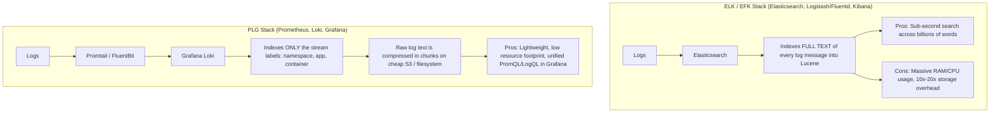

# 📘 Kubernetes Observability II: Logging & Tracing Deep Dive

Welcome to Day 10! While **Metrics** (Day 9) tell you that an anomaly is occurring (e.g., error rate spiked to 15%), **Logs** and **Traces** provide the contextual evidence to answer: **"Exactly which line of code or query broke, and for which user?"**

---

## 1. Why `kubectl logs` Fails in Production 🚫

In local development, `kubectl logs <pod>` is handy. In production, relying on it is dangerous:

1. **Pod Ephemerality & Log Loss**:
   When a pod crashes or is evicted by Kubelet, its container is terminated. If the node disk fills up, container logs in `/var/log/pods` are rotated and permanently lost.
2. **Multi-Replica Needle-in-a-Haystack**:
   If your API has 25 replicas behind a Service, which one handled the failed request? Running `kubectl logs` against 25 individual pods sequentially is impossible during an outage.
3. **No Historical Aggregation**:
   You cannot run queries like *"Show me the error rate trend over the last 14 days"* with `kubectl logs`.
4. **API Server Overload**:
   `kubectl logs` streams data through the Kubernetes API Server. If 5 engineers tail logs during an incident, they can saturate the API Server, degrading cluster control plane responsiveness.

---

## 2. Architecture Comparison: ELK/EFK vs PLG Stack ⚔️



| Factor | **ELK / EFK** | **PLG (Loki)** |
| :--- | :--- | :--- |
| **Indexing Model** | Full-text inverted index (every word indexed). | Label-based index (only metadata is indexed). |
| **Resource Footprint** | Heavy (Needs gigabytes of heap per Elasticsearch node). | Extremely lightweight (runs efficiently even on small nodes). |
| **Storage Backend** | Dedicated cluster disks (SSD recommended). | Object storage (S3, GCS, MinIO, or Local PVC). |
| **Query Language** | Lucene / KQL / Elasticsearch DSL. | **LogQL** (Identical syntax and mental model to PromQL). |
| **Best For** | Dedicated security SIEMs and full-text search requirements. | Cloud-native Kubernetes clusters, SRE on-call, microservice logs. |

---

## 3. The Power of Structured JSON Logging 🧱

Traditional unstructured logs are difficult to parse reliably:
```text
# UNSTRUCTURED (Requires complex, fragile regex)
2026-11-18 14:32:01 ERROR [db-pool] Connection timed out after 3000ms for user 9128
```

Structured JSON logs treat log entries as **typed objects**:
```json
{
  "time": "2026-11-18T14:32:01Z",
  "level": "ERROR",
  "msg": "Connection timed out",
  "service": "payment-api",
  "trace_id": "8f12a9c3b4e0",
  "user_id": 9128,
  "duration_ms": 3000,
  "component": "db-pool"
}
```

### Advantages:
* **Zero Parsing Overhead**: Parsed natively by Loki (`| json`) and Elasticsearch.
* **Type Safety**: Queries can filter mathematically (`| duration_ms > 2000` or `| status >= 500`).
* **Go Standard `log/slog`**: Available natively in Go 1.21+ without third-party dependencies.

---

## 4. Distributed Tracing: Spans, Traces, and Context 🌐

In a distributed microservice architecture, a single user click might traverse:
`Frontend -> API Gateway -> Order Service -> Payment Service -> Database`

If the order fails or takes 4 seconds, **which service caused the delay?**

```mermaid
gantt
    title Distributed Trace Breakdown (Total: 420ms)
    dateFormat X
    axisFormat %s ms

    section Frontend
    GET /checkout           : 0, 420
    section API Gateway
    Route to Order Service  : 20, 400
    section Order Service
    Validate Cart           : 30, 80
    Call Payment Service    : 90, 380
    section Payment Service
    Stripe API Call         : 100, 340
    Insert DB Audit Record  : 345, 375
```

### Core Terminology:
* **Trace**: The end-to-end journey of a request through the system. Identified by a global **`trace_id`**.
* **Span**: A single contiguous unit of work within a trace (e.g., an HTTP handler, an SQL query). Identified by a **`span_id`** and has a **`parent_span_id`**.
* **Context Propagation**: The mechanism of passing `trace_id` and `span_id` across process boundaries via HTTP headers (standardized by the **W3C TraceContext** specification: `traceparent: 00-4bf92f3577b34da6a3ce929d0e0e4736-00f067aa0ba902b7-01`).

---

## 5. LogQL Quick Reference Cheat Sheet 🔍

### 1. Stream Selectors (Targeting sources)
```logql
# All logs from a namespace
{namespace="day10-logging"}

# All logs from a specific app and container
{namespace="day10-logging", app="go-logging-app", container="api"}
```

### 2. Line Filter Expressions
```logql
# Substring match (contains "error")
{app="go-logging-app"} |= "error"

# Exclude match (does not contain "healthz")
{app="go-logging-app"} != "healthz"

# Regex match (case-insensitive error or timeout)
{app="go-logging-app"} |~ "(?i)error|timeout"

# Regex negative match
{app="go-logging-app"} !~ "DEBUG|TRACE"
```

### 3. JSON Parsing & Label Extraction
```logql
# Parse JSON line into labels
{app="go-logging-app"} | json

# Parse JSON and filter by extracted properties
{app="go-logging-app"} | json | status >= 500
{app="go-logging-app"} | json | duration_ms > 200 and level = "ERROR"
```

### 4. Metric Queries (Log-to-Metric)
```logql
# Error rate per second
sum(rate({app="go-logging-app"} |= "error" [1m])) by (pod)

# Total log volume over 5 minutes
count_over_time({app="go-logging-app"}[5m])
```

---

## 6. SRE Interview Questions: Logging & Tracing 🎯

### Q1: "How do you correlate logs and traces during an incident?"
**Answer**: By injecting the distributed tracing `trace_id` and `span_id` into the structured log fields of every service. When viewing an alert in Grafana or a trace in Jaeger, engineers can jump directly from the trace view into Loki logs filtered by `trace_id` to inspect the exact error messages and variable states.

### Q2: "Why does Loki scale better than Elasticsearch in high-throughput clusters?"
**Answer**: Elasticsearch indexes every word of every log line in an inverted Lucene index, which requires substantial CPU and RAM, and causes the index size to often exceed the size of the raw data itself. Loki indexes only the metadata labels (like namespace, pod, and container), leaving the log text unindexed until query time. At query time, Loki parallelizes regex grep operations across chunks stored in cheap object storage, making ingestion 10x faster and storage significantly cheaper.
