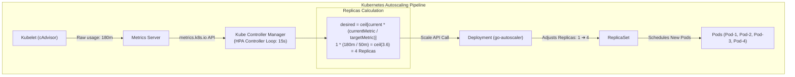

# Day 11: Auto-Scaling (HPA & VPA)

## 🎯 Goal
Master automatic workload scaling in Kubernetes. Understand the mathematics and control loops behind the **Horizontal Pod Autoscaler (HPA)**, observe dynamic scale-out and scale-in under real traffic spikes, explore **Vertical Pod Autoscaler (VPA)** recommendations, and diagnose the common production failure mode where HPA reports `<unknown>/50%`.

---

## 🏗️ Architecture: The HPA Control Loop



---

## 📋 Prerequisites & Image Build

### 1. Build the Go Autoscaling App
```powershell
cd day11/app
docker build -t k8s-day11:v1 .
```

### 2. Import into Cluster (If using k3d / k3s)
```powershell
k3d image import k8s-day11:v1 -c k8s-class
```

### 3. Ensure Metrics Server is Running
HPA requires an active `metrics-server` to query CPU and Memory usage:
```powershell
kubectl top nodes
```
*(If you need to install or verify the Metrics Server, check [day9/k8s/02-metrics-server.yaml](file:///c:/Users/Sidharth/Desktop/kubernetes/day9/k8s/02-metrics-server.yaml)).*

---

## 🧪 Step-by-Step Hands-on Labs

### Lab 1: Deploy the Microservice & Namespace

1. Create the namespace and deploy the Go microservice with 1 initial replica:
```powershell
cd ../k8s
kubectl apply -f 01-namespace.yaml
kubectl apply -f 02-deployment.yaml
kubectl apply -f 03-service.yaml
```

2. Verify that the initial pod is running:
```powershell
kubectl get pods -n day11-autoscaling -l app=go-autoscaler
```

---

### Lab 2: Configure the Horizontal Pod Autoscaler (HPA)

1. Apply the HPA manifest:
```powershell
kubectl apply -f 04-hpa.yaml
```

2. Inspect the HPA status:
```powershell
kubectl get hpa -n day11-autoscaling
```
**Expected Initial Output:**
```text
NAME                REFERENCE                  TARGETS         MINPODS   MAXPODS   REPLICAS   AGE
go-autoscaler-hpa   Deployment/go-autoscaler   cpu: 0%/50%     1         5         1          30s
```
* **Target: 50%**: Means 50% of the pod's `requests.cpu` (0.5 * 100m = **50m CPU**).
* Whenever average CPU usage across pods exceeds 50m, HPA will scale up!

---

### Lab 3: Generate High Load & Observe Scale-Up

1. Open two separate terminal windows side-by-side.
   * **Terminal 1: Watch the HPA react:**
     ```powershell
     kubectl get hpa go-autoscaler-hpa -n day11-autoscaling -w
     ```
   * **Terminal 2: Watch Pods being scheduled:**
     ```powershell
     kubectl get pods -n day11-autoscaling -l app=go-autoscaler -w
     ```

2. In a **third terminal**, launch the load generator:
```powershell
kubectl apply -f 05-load-generator.yaml
```

3. Watch the terminals:
   * Within **15-30 seconds**, the load generator stresses the CPU with concurrent hashing rounds.
   * The HPA terminal will report:
     ```text
     TARGETS: cpu: 180%/50%
     REPLICAS: 1 -> 4
     ```
   * The Pods terminal will immediately show 3 new pods launching and reaching `Running` state!
   * As load spreads across 4 pods, average CPU usage drops back down toward the 50% target.

---

### Lab 4: Stop Load & Observe Stabilization Cooldown

1. Delete the load generator:
```powershell
kubectl delete -f 05-load-generator.yaml
```

2. Watch the HPA terminal:
   * CPU utilization immediately drops to `0%/50%`.
   * **Notice:** The pods do *not* terminate immediately!
   * In `04-hpa.yaml`, we configured `behavior.scaleDown.stabilizationWindowSeconds: 60`.
   * The HPA waits for the stabilization window to pass to ensure traffic spikes haven't simply paused.
   * After 60 seconds, HPA scales the deployment back down from **4 replicas to 1 replica**!

---

### Lab 5: Debug Scenario - The `<unknown>/50%` Bug

A ubiquitous production incident: *You configure an HPA, but it stays stuck at `<unknown>/50%` and refuses to scale.*

#### 1. Simulate the Bug:
Deploy a version of the app and HPA where the pod spec **omits `requests`**:
```powershell
kubectl apply -f 07-deployment-no-requests.yaml
kubectl apply -f 08-hpa-broken.yaml
```

#### 2. Observe the Failure:
```powershell
kubectl get hpa go-autoscaler-broken-hpa -n day11-autoscaling
```
**Output:**
```text
NAME                      REFERENCE                         TARGETS           MINPODS   MAXPODS   REPLICAS
go-autoscaler-broken-hpa  Deployment/go-autoscaler-broken   cpu: <unknown>/50% 1         5         1
```

#### 3. Diagnose the Root Cause:
Run `describe` on the broken HPA:
```powershell
kubectl describe hpa go-autoscaler-broken-hpa -n day11-autoscaling
```
Look under **Conditions -> AbleToScale** and **FailedGetResourceMetric**:
```text
Warning  FailedGetResourceMetric  missing request for cpu on container api in pod ...
```
> 💡 **Why?** You asked HPA to target **50% of CPU**. But 50% of *what*? The percentage is mathematically defined as:  
> $$\text{Utilization} = \frac{\text{Actual Usage}}{\text{Requested CPU}} \times 100$$  
> If `requests.cpu` is omitted, the denominator is zero/undefined, and HPA cannot compute the ratio!

#### 4. Restore:
Clean up the broken deployment and HPA:
```powershell
kubectl delete -f 07-deployment-no-requests.yaml -f 08-hpa-broken.yaml
```

---

### Lab 6: Vertical Pod Autoscaler (VPA) Exploration

While HPA changes the *number* of pods (horizontal scaling), VPA resizes the *resources* (CPU/Memory requests and limits) of each individual pod (vertical scaling).

1. Inspect the VPA manifest:
```powershell
cat 06-vpa.yaml
```
Notice:
* `updateMode: "Off"`: Generates right-sizing recommendations without restarting pods.
* `controlledResources: ["cpu", "memory"]`.

2. **Can HPA and VPA run together?**
   * ⚠️ **Danger**: You should **never** run HPA and VPA simultaneously on the **same metric** (e.g., both targeting CPU).
   * If CPU spikes, HPA tries to add more pods while VPA tries to make each pod bigger, causing resource flapping and race conditions.
   * **Safe Pattern**: Use HPA on **CPU/Traffic** and VPA on **Memory**, or run VPA in `updateMode: "Off"` purely as an advisory tool.

---

## 🧹 Cleanup
To delete all resources created in Day 11:
```powershell
kubectl delete namespace day11-autoscaling
```
