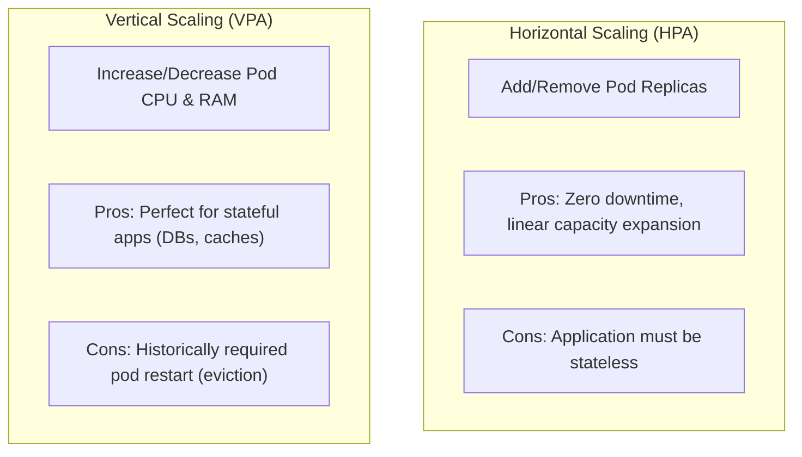

# 📘 Kubernetes Autoscaling: HPA, VPA, and Production Sizing

Welcome to Day 11! Autoscaling is what makes cloud-native architectures cost-efficient and resilient to unexpected traffic surges. Today we demystify how Kubernetes dynamically scales workloads.

---

## 1. Horizontal vs Vertical Scaling: The Tradeoff ⚖️



| Dimension | **HPA (Horizontal Pod Autoscaler)** | **VPA (Vertical Pod Autoscaler)** |
| :--- | :--- | :--- |
| **Action** | Changes `replicas` in Deployment/StatefulSet. | Modifies `resources.requests` and `limits` in Pod spec. |
| **Best For** | Stateless web APIs, event consumers, microservices. | Monoliths, stateful databases, batch workloads, sizing discovery. |
| **Downtime** | None (seamless rolling addition of pods). | Can require pod eviction & restart (unless using K8s 1.27+ In-Place resize). |
| **Target Metrics** | CPU, Memory, Custom metrics (HTTP requests/sec, Queue depth). | Historical CPU and Memory usage patterns over time. |

---

## 2. The Core HPA Algorithm 🧮

Every 15 seconds (configurable via `--horizontal-pod-autoscaler-sync-period`), the HPA controller evaluates:

$$\text{desiredReplicas} = \left\lceil \text{currentReplicas} \times \left( \frac{\text{currentMetricValue}}{\text{targetMetricValue}} \right) \right\rceil$$

### Concrete Example:
* You have **1 replica** running.
* Pod `requests.cpu: 100m`.
* HPA target: **50%** (i.e., **50m** target).
* Traffic arrives: Current measured CPU usage spikes to **180m**.
* Ratio: $\frac{180\text{m}}{50\text{m}} = 3.6$.
* Desired Replicas: $\lceil 1 \times 3.6 \rceil = \mathbf{4\text{ replicas}}$.

The controller immediately patches the Deployment replicas from 1 to 4!

---

## 3. The `<unknown>/50%` Problem Explained ⚠️

When you see:
```text
NAME                REFERENCE                  TARGETS           MINPODS   MAXPODS   REPLICAS
go-autoscaler-hpa   Deployment/go-autoscaler   cpu: <unknown>/50% 1         5         1
```
There are only **two possible root causes**:

1. **Missing `resources.requests.cpu` in the Pod spec**:
   The percentage calculation requires a baseline:
   $$\text{Utilization} \% = \frac{\text{Actual Usage (from cAdvisor)}}{\text{Requested CPU}} \times 100$$
   If `requests.cpu` is omitted, division by zero occurs, and Kubernetes sets the metric to `<unknown>`.
2. **Metrics Server is Down or Unreachable**:
   If the Kubelet or Metrics Server has TLS issues or is stopped, HPA cannot fetch the raw usage.

---

## 4. Preventing Flapping & Controlling Cooldowns 🛡️

**What is Flapping (Thrashing)?**  
If traffic oscillates rapidly, an uncontrolled autoscaler might scale up to 10 pods, scale down to 1 pod 20 seconds later, then scale back up to 10 pods, causing severe CPU thrashing and cascading timeouts.

### HPA Stabilization Windows:
In Kubernetes `autoscaling/v2`, you can configure explicit scale-down and scale-up behaviors:

```yaml
behavior:
  scaleDown:
    # Wait 300 seconds (5 mins) of quiet traffic before terminating pods
    stabilizationWindowSeconds: 300
    policies:
    # Never kill more than 10% of total pods per minute during scale down
    - type: Percent
      value: 10
      periodSeconds: 60
  scaleUp:
    # React to spikes with zero delay
    stabilizationWindowSeconds: 0
    policies:
    # Double the fleet if needed
    - type: Percent
      value: 100
      periodSeconds: 15
```

---

## 5. VPA Modes: Discovery vs Automation 🔍

The Vertical Pod Autoscaler operates in 4 distinct modes:

1. **`Off` (Advisory Mode)**:
   Computes recommendations (`Target`, `LowerBound`, `UpperBound`, `UncappedTarget`) but modifies **nothing**. Perfect for learning the true resource requirements of an unknown service.
2. **`Initial`**:
   Assigns recommended requests/limits only when new pods are being created, but never evicts running pods.
3. **`Recreate` / `Auto`**:
   Evicts existing pods and restarts them with updated resource values whenever recommendations diverge significantly from current specs.
4. **`InPlace` (Kubernetes 1.27+ Feature Gate)**:
   Resizes CPU/Memory dynamically without restarting the container!

---

## 6. Interview Questions for Senior Engineers 🎯

### Q1: "Can we use HPA and VPA together on the same Deployment?"
**Answer**:  
Not on the same metric! If both HPA and VPA scale based on CPU, a traffic spike causes HPA to add more pods while VPA simultaneously resizes each pod larger. When traffic drops, both try to shrink at the same time, leading to severe resource instability.  
**Valid combinations**:
- HPA scaling on **CPU or Custom Metrics** (e.g. SQS queue length) + VPA scaling on **Memory**.
- HPA managing live replicas while VPA runs in **`updateMode: "Off"`** as a monitoring advisor.

### Q2: "Why do we scale on CPU requests instead of CPU limits?"
**Answer**:  
Because the Kubernetes scheduler places pods onto nodes exclusively based on **requests**. If HPA evaluated against limits, a pod could consume 90% of its request while appearing at only 30% of its limit, delaying scale-out until after the service is already suffering latency degradation or throttling.

### Q3: "What is KEDA and when do you need it?"
**Answer**:  
**KEDA (Kubernetes Event-Driven Autoscaling)** is an open-source CNCF project that extends HPA. Standard HPA only natively knows about CPU and Memory from the metrics-server. KEDA acts as an external metrics adapter that allows scaling on 60+ external triggers: Kafka lag, RabbitMQ queue depth, Redis lists, AWS SQS, or database table row counts, even scaling **to zero (0 replicas)** when queues are empty!
