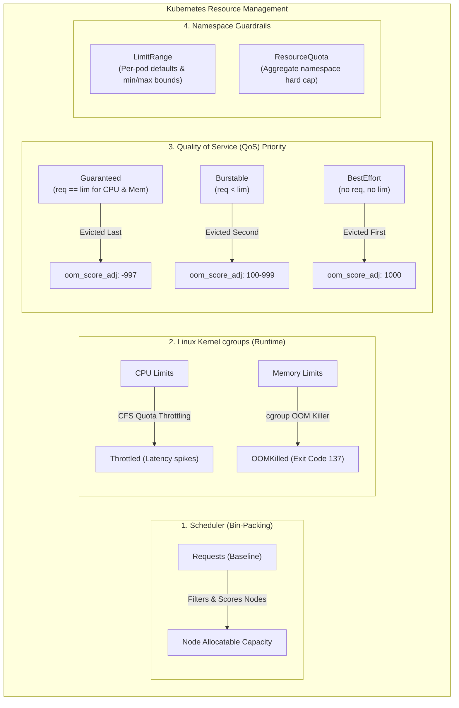

# Day 8: Resource Management & QoS

## 🎯 Goal
Prevent the **"Noisy Neighbor"** problem in production clusters. Master CPU/Memory **Requests vs Limits**, explore the three **Quality of Service (QoS)** classes, simulate and troubleshoot **OOMKilled (Exit Code 137)** events, and enforce namespace guardrails using **LimitRanges** and **ResourceQuotas**.

---

## 🏗️ Architecture & Concepts



---

## 📋 Prerequisites & Image Build

### 1. Build the Go Resource Demo Image
```powershell
cd day8/app
docker build -t k8s-day8:v1 .
```

### 2. Import Image into k3d (If using k3s/k3d)
If you are running the `k8s-class` cluster from previous days:
```powershell
k3d image import k8s-day8:v1 -c k8s-class
```
*(If using Docker Desktop Kubernetes or Minikube with `eval $(minikube docker-env)`, the local build is already accessible).*

### 3. Create the Dedicated Namespace
```powershell
cd ../k8s
kubectl apply -f 01-namespace.yaml
```

Verify:
```powershell
kubectl get ns day8-resources
```

---

## 🧪 Step-by-Step Hands-on Labs

> ⚠️ **Important Execution Note**: Run the labs in sequence! Do not run `kubectl apply -f .` all at once. Manifests `06-limitrange.yaml` and `07-resourcequota.yaml` act as admission guardrails; applying them beforehand will automatically inject defaults into the BestEffort pod and block unconstrained pods.

### Lab 1: Exploring QoS Classes (Guaranteed, Burstable, BestEffort)

Kubernetes automatically assigns a **QoS Class** to every Pod upon creation based solely on its container requests and limits.

#### 1. Deploy the 3 QoS Pods
```powershell
kubectl apply -f 02-qos-besteffort.yaml
kubectl apply -f 03-qos-burstable.yaml
kubectl apply -f 04-qos-guaranteed.yaml
```

#### 2. Verify QoS Classification
Run the following command to see how Kubernetes categorized each Pod:
```powershell
kubectl get pods -n day8-resources -o custom-columns=NAME:.metadata.name,QOS:.status.qosClass,STATUS:.status.phase
```

**Expected Output:**
```text
NAME                 QOS          STATUS
qos-besteffort-pod   BestEffort   Running
qos-burstable-pod    Burstable    Running
qos-guaranteed-pod   Guaranteed   Running
```

#### 3. Inspect Linux Kernel OOM Score Adjustment
Kubernetes translates QoS into the Linux kernel `oom_score_adj` inside the container cgroup. You can verify this directly:
```powershell
# BestEffort has the highest oom_score_adj (1000) -> First to die
kubectl exec -it qos-besteffort-pod -n day8-resources -- cat /proc/1/oom_score_adj

# Guaranteed has oom_score_adj set to -997 -> Immune until BestEffort & Burstable are evicted
kubectl exec -it qos-guaranteed-pod -n day8-resources -- cat /proc/1/oom_score_adj
```

---

### Lab 2: Simulating & Diagnosing `OOMKilled` (Exit Code 137)

Memory is an **incompressible resource**. When a container attempts to allocate more memory than its limit, the Linux cgroup triggers the Out-Of-Memory (OOM) Killer. The process receives `SIGKILL` (signal 9), resulting in **Exit Code 137** (`128 + 9 = 137`).

#### 1. Deploy the OOM Demo Pod (Strict 50Mi Limit)
```powershell
kubectl apply -f 05-oomkill-pod.yaml
```

Wait until it is in `Running` state:
```powershell
kubectl get pod oomkill-demo-pod -n day8-resources
```

#### 2. Forward the Port to Access the Application
Open a dedicated terminal (or run in background):
```powershell
kubectl port-forward pod/oomkill-demo-pod 8080:8080 -n day8-resources
```

#### 3. Check Current Memory Baseline
In a second terminal:
```powershell
curl http://localhost:8080/
```
Observe that the Go app currently uses ~10 MB of memory.

#### 4. Trigger OOM by Requesting 80 MB Allocation
The pod limit is **50Mi**. We will ask the app to allocate **80 MB**:
```powershell
curl "http://localhost:8080/allocate?mb=80"
```
*(The command will drop the connection or return an empty response because the container is terminated immediately by the kernel).*

#### 5. Inspect the OOMKilled Post-Mortem
Check the status of the pod:
```powershell
kubectl get pod oomkill-demo-pod -n day8-resources
```
**Output:**
```text
NAME               READY   STATUS      RESTARTS   AGE
oomkill-demo-pod   0/1     OOMKilled   0          2m
```

#### 6. Deep Dive with `describe`
```powershell
kubectl describe pod oomkill-demo-pod -n day8-resources
```
Look under the **Containers -> State** and **Events** section:
```text
    State:          Terminated
      Reason:       OOMKilled
      Exit Code:    137
      Started:      ...
      Finished:     ...
```
> 💡 **Why 137?** In Unix/Linux, any process terminated by an uncaught signal exits with code `128 + signal_number`. Signal 9 is `SIGKILL`. `128 + 9 = 137`.

---

### Lab 3: Namespace Guardrails with `LimitRange`

A `LimitRange` sets default requests/limits for containers that forget to define them, and enforces minimum and maximum boundary rules per container.

#### 1. Apply the LimitRange
```powershell
kubectl apply -f 06-limitrange.yaml
```

Inspect the configured limits:
```powershell
kubectl describe limitrange dev-limit-range -n day8-resources
```

#### 2. Observe Automatic Defaulting
Deploy an unconfigured pod (like our BestEffort pod or a simple test pod) without specifying any resources:
```powershell
kubectl run test-defaults --image=k8s-day8:v1 --restart=Never -n day8-resources
```

Check the generated pod spec:
```powershell
kubectl get pod test-defaults -n day8-resources -o yaml | findstr -A 10 resources:
```
**Result:** Kubernetes automatically injected:
```yaml
resources:
  limits:
    cpu: 300m
    memory: 256Mi
  requests:
    cpu: 100m
    memory: 64Mi
```
And its QoS became **Burstable** instead of BestEffort!

#### 3. Test Boundary Enforcement (Min/Max Rejection)
Try creating a container asking for 1 GiB memory (which exceeds the `max: 512Mi` rule):
```powershell
kubectl run test-too-large --image=k8s-day8:v1 --restart=Never -n day8-resources --requests='memory=1Gi'
```
**Result:**
```text
Error from server (Forbidden): pods "test-too-large" is forbidden: maximum memory usage per Container is 512Mi, but request is 1Gi
```
Clean up the test pods:
```powershell
kubectl delete pod test-defaults test-too-large -n day8-resources --ignore-not-found=true
```

---

### Lab 4: Namespace Guardrails with `ResourceQuota`

While a `LimitRange` sets rules for *individual containers*, a `ResourceQuota` caps the **aggregate sum** of resources across the *entire namespace*.

#### 1. Apply the ResourceQuota
```powershell
kubectl apply -f 07-resourcequota.yaml
```

#### 2. Check Initial Quota Usage
```powershell
kubectl describe resourcequota namespace-quota -n day8-resources
```
**Output shows Used vs Hard limit:**
```text
Resource        Used    Hard
--------        ----    ----
count/pods      3       4
limits.cpu      650m    1
limits.memory   384Mi   1Gi
requests.cpu    350m    500m
requests.memory 217Mi   512Mi
```

#### 3. Attempt to Exceed the Quota
Try applying `08-quota-exceed-pod.yaml`, which requests `300m CPU` and `400Mi Memory`. While each container individually satisfies the LimitRange, adding them to the existing pods (`requests.cpu: 350m`, `requests.memory: 217Mi`) exceeds the namespace quota of `500m CPU` and `512Mi Memory`:
```powershell
kubectl apply -f 08-quota-exceed-pod.yaml
```

**Expected Error (Admission Controller Rejection):**
```text
Error from server (Forbidden): pods "greedy-pod" is forbidden: exceeded quota: namespace-quota, 
requested: requests.cpu=300m,requests.memory=400Mi, 
used: requests.cpu=350m,requests.memory=217Mi, 
limited: requests.cpu=500m,requests.memory=512Mi
```
The Kubernetes API server rejects the request at admission time before it even reaches the scheduler!

---

## 🎤 Interview Deep Dive: "Why is setting CPU limits controversial?"

### The Problem: CFS (Completely Fair Scheduler) Bandwidth Control
Unlike memory (which is terminated on overflow), CPU is a **compressible resource**. When a container hits its CPU limit, it is **throttled** (slowed down), not killed.

Linux enforces CPU limits using **quota periods** (default 100ms):
- If `limits.cpu: "200m"` (0.2 CPU), the container is allocated **20ms of CPU runtime per 100ms period**.
- In multi-threaded applications (Go, Java, Node.js worker pools), if 4 threads perform work simultaneously, they consume 20ms of CPU time in just **5ms of real wall-clock time**.
- For the remaining **95ms of that period**, the container's threads are completely frozen by the Linux kernel scheduler!
- This causes inexplicable **p99 latency spikes** and connection timeouts even when the node has plenty of idle CPU capacity.

### Production Best Practice:
1. **Always set `requests.cpu`**: Ensures the scheduler places pods accurately based on guaranteed baseline capacity.
2. **Always set `requests.memory` and `limits.memory`**: Memory is incompressible, so limits are essential to prevent node-level OOM panics.
3. **Be cautious with `limits.cpu`**: Many high-throughput engineering teams (e.g., Buffer, Datadog) set CPU requests but omit CPU limits, allowing pods to burst into unused node CPU without experiencing CFS period throttling.

---

## 🧹 Cleanup
To clean up all resources created in this lab:
```powershell
kubectl delete namespace day8-resources
```
Verify the namespace has terminated:
```powershell
kubectl get ns day8-resources
```
