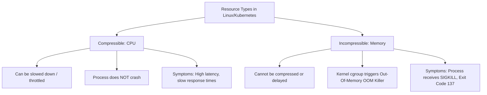
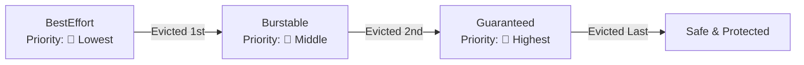

# 📘 Kubernetes Resource Management & QoS: The Comprehensive Guide

Welcome to Day 8! Today we tackle one of the most critical aspects of running Kubernetes in production: **ensuring workloads play nicely together and preventing the "Noisy Neighbor" problem**.

---

## 1. The Core Problem: The "Noisy Neighbor" 🔊

Imagine you live in an apartment building:
* If your neighbor throws a wild party and blasts music all night, your sleep is ruined.
* If your neighbor turns on all their taps and drains the building's water tank, you can't take a shower.

In Kubernetes, your **Nodes** are the apartment building, and the **Pods** are the tenants.
If one pod starts hogging all the CPU or running an uncontrolled memory leak, it can starve critical system pods (like `kubelet` or `coredns`) or crash other business applications.

Resource Management in Kubernetes gives you the tools to set clear boundaries and guarantees.

---

## 2. Requests vs Limits: The Golden Distinction ⚖️

| Attribute | **Requests** (What you ask for) | **Limits** (The hard ceiling) |
| :--- | :--- | :--- |
| **Primary Audience** | **Kubernetes Scheduler** | **Linux Kernel cgroups** |
| **When it matters** | At **Pod Creation / Scheduling** time | At **Pod Runtime** |
| **Analogy** | "I guarantee I need at least 1 seat at the table." | "If you eat more than 3 plates, security kicks you out." |
| **What happens if exceeded?** | Allowed to exceed if the Node has spare capacity. | For CPU: **Throttled**.<br/>For Memory: **OOMKilled**. |
| **Resource Type** | Used for capacity planning and node bin-packing. | Used to protect the host node from starvation. |

### Units to Remember:
* **CPU**: Measured in cores or millicores (`m`).
  * `1000m` = `1 CPU core` (or 1 vCPU / hyperthread).
  * `250m` = `0.25 CPU core` (25% of one vCPU).
* **Memory**: Measured in bytes or mebibytes (`Mi` = $2^{20}$ bytes) / gibibytes (`Gi` = $2^{30}$ bytes).
  * `128Mi` = 128 Mebibytes. Always prefer power-of-two notations (`Mi`, `Gi`) over decimal (`M`, `G`) in Kubernetes.

---

## 3. Compressible vs Incompressible Resources 🧱

This is a fundamental concept in operating systems:



---

## 4. The 3 Quality of Service (QoS) Classes 🎖️

When a Node runs out of memory (Node Memory Pressure), the `kubelet` must evict pods to keep the node alive. **How does it decide who dies first?**

By inspecting the Pod's **Quality of Service (QoS)** class!



### 1. `Guaranteed` (VIP Class 🏆)
* **Rule**: Every single container in the Pod must have both CPU and Memory requests and limits set, AND:
  * `requests.cpu == limits.cpu`
  * `requests.memory == limits.memory`
* **Linux Score**: `oom_score_adj = -997` (almost immune to OOM eviction).
* **When to use**: Core databases, primary payment APIs, critical production workers.

### 2. `Burstable` (Business Class 🎫)
* **Rule**: The Pod does not meet the Guaranteed criteria, but has at least one container with a CPU or memory request or limit specified.
  * Usually: `requests < limits`.
* **Linux Score**: `oom_score_adj` is dynamically calculated based on how much memory the pod uses relative to what it requested.
* **When to use**: Standard web apps, microservices, background job processors.

### 3. `BestEffort` (Standby / Hitchhiker 🎒)
* **Rule**: No requests and no limits are set on ANY container in the Pod.
* **Linux Score**: `oom_score_adj = 1000` (highest possible kill priority).
* **When to use**: Non-essential batch jobs, scratch test pods, CI/CD runners where failure is acceptable.

---

## 5. LimitRange vs ResourceQuota: The Guardrails 🛡️

| Feature | **LimitRange** | **ResourceQuota** |
| :--- | :--- | :--- |
| **Metaphor** | The **Bouncer** at the club entrance checking each person's outfit. | The **Fire Marshal's Maximum Occupancy** sign on the building. |
| **Scope** | **Per-Container** or **Per-Pod** within a namespace. | **Entire Namespace** (Aggregate total). |
| **What it does** | 1. Injects **default** requests/limits if omitted.<br/>2. Enforces **min/max** boundaries on single containers.<br/>3. Limits the `maxLimitRequestRatio`. | 1. Caps total CPU/Memory requested across all pods.<br/>2. Caps total CPU/Memory limits across all pods.<br/>3. Caps total number of Pods, Services, PVCs, etc. |
| **Behavior if violated** | Pod rejected at admission if it asks for > max or < min. | Pod rejected at admission if its addition causes namespace totals to exceed the quota. |

---

## 6. OOMKilled Post-Mortem Checklist 🔍

When a pod crashes with `OOMKilled`:

1. **Verify Exit Code**:
   ```bash
   kubectl describe pod <pod-name>
   ```
   Look for: `Reason: OOMKilled` and `Exit Code: 137`.

2. **Check Container Limits**:
   Did the pod exceed its own container limit (`limits.memory`), or did the entire node run out of RAM?
   * If container exceeded limit: container terminates with `OOMKilled`, node stays healthy.
   * If node ran out of RAM: `kubelet` evicts pods based on QoS class and logs `Evicted` / `NodeMemoryPressure`.

3. **Check Historical Usage**:
   ```bash
   kubectl top pod <pod-name>
   ```
   (Requires `metrics-server` installed).

4. **Fix Strategy**:
   * Profile application heap and memory leaks.
   * Increase `limits.memory` in deployment manifest.
   * Configure runtime garbage collection tuning (e.g., `GOMEMLIMIT` in Go 1.19+ or `-XX:MaxRAMPercentage` in Java).

---

## 7. Useful Diagnostic Commands Cheat Sheet 💻

```bash
# View Pods with their QoS class in one clean table
kubectl get pods -A -o custom-columns=NAMESPACE:.metadata.namespace,NAME:.metadata.name,QOS:.status.qosClass

# View raw oom_score_adj inside a running pod
kubectl exec -it <pod-name> -- cat /proc/1/oom_score_adj

# Check namespace resource quota consumption
kubectl describe resourcequota <quota-name> -n <namespace>

# Check namespace limit range defaults and bounds
kubectl describe limitrange <limitrange-name> -n <namespace>

# Find any pods that were OOMKilled recently
kubectl get pods --field-selector=status.phase=Failed -A
```
