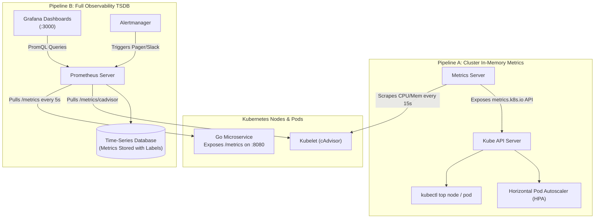

# Day 9: Observability I - Monitoring (Prometheus & Grafana)

## 🎯 Goal
Understand the complete observability pipeline in Kubernetes. Deploy and configure the **Metrics Server** for `kubectl top` and HPA, instrument a custom Go microservice to expose application metrics at `/metrics`, deploy **Prometheus** to scrape time-series data, visualize real-time dashboards in **Grafana**, and solve real-world debugging scenarios.

---

## 🏗️ Architecture: Metrics Server vs Prometheus



---

## 📋 Prerequisites & Image Build

### 1. Build the Instrumented Go App
```powershell
cd day9/app
docker build -t k8s-day9:v1 .
```

### 2. Import into Cluster (If using k3d / k3s)
```powershell
k3d image import k8s-day9:v1 -c k8s-class
```

### 3. Create the Dedicated Namespace
```powershell
cd ../k8s
kubectl apply -f 01-namespace.yaml
```

---

## 🧪 Step-by-Step Hands-on Labs

### Lab 1: Deploy & Test Metrics Server (`kubectl top`)

The Metrics Server collects CPU and memory usage from `cAdvisor` running inside every node's Kubelet, storing only current values in memory (no historical disk storage).

#### 1. Apply the Metrics Server
```powershell
kubectl apply -f 02-metrics-server.yaml
```

Wait until the Metrics Server pod is `Running` and its APIService is registered:
```powershell
kubectl get pods -n kube-system -l k8s-app=metrics-server
kubectl get apiservice v1beta1.metrics.k8s.io
```
*(Look for `AVAILABLE: True`)*.

#### 2. Run `kubectl top`
Give the metrics-server ~30-60 seconds to complete its first collection cycle, then run:
```powershell
# Check Node Resource Usage
kubectl top nodes

# Check Pod Resource Usage across all namespaces
kubectl top pods -A
```

**Expected Output:**
```text
NAME                     CPU(cores)   CPU%   MEMORY(bytes)   MEMORY%   
k3d-k8s-class-server-0   45m          1%     380Mi           4%        
k3d-k8s-class-agent-0    30m          0%     210Mi           2%        
```

---

### Lab 2: Deploy the Instrumented Go Microservice

Our Go app uses the official Prometheus Go client library (`github.com/prometheus/client_golang`) to register custom application metrics:
* `http_requests_total`: Counter tracking total requests, labeled by `method`, `path`, and `status`.
* `http_request_duration_seconds`: Histogram measuring response latency buckets.
* `http_active_requests`: Gauge tracking currently in-flight requests.
* Standard Go runtime metrics: Memory heap, GC pauses, goroutines.

#### 1. Deploy the App and Service
```powershell
kubectl apply -f 03-go-app-deployment.yaml
kubectl apply -f 04-go-app-service.yaml
```

Wait until all 3 replicas are running:
```powershell
kubectl get pods -n day9-monitoring -l app=go-metrics-app
```

#### 2. Verify the `/metrics` Endpoint
Forward port 8080 locally to inspect the raw Prometheus exposition format:
```powershell
kubectl port-forward svc/go-metrics-app 8080:8080 -n day9-monitoring
```
In your browser or terminal:
```powershell
curl http://localhost:8080/metrics
```
Notice the formatted metrics lines, e.g.:
```text
# HELP http_requests_total Total number of HTTP requests processed...
# TYPE http_requests_total counter
http_requests_total{method="GET",path="/healthz",status="200"} 4
```

---

### Lab 3: Deploy Prometheus & Grafana

We provide two deployment options:

#### Option A: Quick Standalone Deploy (Zero Prerequisites, No Helm Required)
This installs a production-aligned Prometheus and Grafana stack pre-configured with Kubernetes Service Discovery and Prometheus pre-wired as the Default Grafana datasource:
```powershell
kubectl apply -f 05-prometheus-standalone.yaml
kubectl apply -f 06-grafana-standalone.yaml
```

Wait for both deployments to reach `1/1`:
```powershell
kubectl get pods -n day9-monitoring
```

#### Option B: Using Helm (If Helm is installed on your machine)
```powershell
helm repo add prometheus-community https://prometheus-community.github.io/helm-charts
helm repo update
helm install prometheus-stack prometheus-community/kube-prometheus-stack -n day9-monitoring
kubectl apply -f 08-servicemonitor.yaml
```

---

### Lab 4: Generate Live Traffic
Deploy the traffic generator pod, which continuously sends requests with varied parameters to simulate live production traffic:
```powershell
kubectl apply -f 07-traffic-generator.yaml
```

Verify traffic logs:
```powershell
kubectl logs -f deployment/traffic-generator -n day9-monitoring
```

---

### Lab 5: PromQL Mastery in Prometheus UI

#### 1. Access Prometheus Web UI
```powershell
kubectl port-forward svc/prometheus 9090:9090 -n day9-monitoring
```
Open your browser to: **http://localhost:9090**

#### 2. Check Scrape Targets
Navigate to **Status -> Targets**.
Verify that `go-metrics-app` is listed in state **UP (1/1)**.

#### 3. Execute Core PromQL Queries

1. **Total Request Rate (Requests Per Second across all endpoints):**
   ```promql
   sum(rate(http_requests_total[1m]))
   ```

2. **Request Rate Grouped by HTTP Status Code:**
   ```promql
   sum(rate(http_requests_total[1m])) by (status)
   ```

3. **HTTP Error Rate Percentage (5xx Errors / Total Requests):**
   ```promql
   (sum(rate(http_requests_total{status=~"5.."}[1m])) / sum(rate(http_requests_total[1m]))) * 100
   ```

4. **95th Percentile Latency (p95 in seconds):**
   ```promql
   histogram_quantile(0.95, sum(rate(http_request_duration_seconds_bucket[1m])) by (le))
   ```

5. **Current In-Flight Active Requests:**
   ```promql
   http_active_requests
   ```

6. **Go Memory Allocation (Megabytes):**
   ```promql
   go_memstats_alloc_bytes{job="go-metrics-app"} / 1024 / 1024
   ```

---

### Lab 6: Visualize in Grafana

#### 1. Access Grafana
```powershell
kubectl port-forward svc/grafana 3000:3000 -n day9-monitoring
```
Open your browser to: **http://localhost:3000**
* **Username**: `admin`
* **Password**: `admin`

#### 2. Verify Data Source
Go to **Connections -> Data sources**. You will see **Prometheus** pre-configured and connected to `http://prometheus:9090`. Click **Save & test** to verify the green checkmark!

#### 3. Build a Dashboard
Click **Dashboards -> New Dashboard -> Add visualization**:
* Select **Prometheus** as data source.
* Add Query A: `sum(rate(http_requests_total[1m])) by (status)`
* Title: **Requests Per Second by Status Code**
* Add a second panel: `histogram_quantile(0.95, sum(rate(http_request_duration_seconds_bucket[1m])) by (le)) * 1000`
* Title: **p95 Latency (ms)**
* Set auto-refresh to **5s**. Watch the live graph update in real time!

---

### Lab 7: Debug Scenario - Metrics Server Down!

A common production on-call issue: `kubectl top` suddenly stops working and HPA cannot scale pods.

#### 1. Simulate the Breakdown
Scale down the metrics-server:
```powershell
kubectl scale deployment/metrics-server -n kube-system --replicas=0
```

Try running `kubectl top`:
```powershell
kubectl top nodes
```
**Error Observed:**
```text
error: Metrics API not available
```

#### 2. How to Diagnose:
1. Check the registered APIService:
   ```powershell
   kubectl get apiservice v1beta1.metrics.k8s.io
   ```
   **Output:** `AVAILABLE: False (ServiceNotFound)` or failing heartbeat.

2. Check the backing deployment status:
   ```powershell
   kubectl get deployment metrics-server -n kube-system
   ```

#### 3. Restore the Service:
```powershell
kubectl scale deployment/metrics-server -n kube-system --replicas=1
```
Wait 30 seconds and re-run:
```powershell
kubectl top nodes
```
`kubectl top` is restored!

---

## 🧹 Cleanup
To clean up all resources created in Day 9:
```powershell
kubectl delete namespace day9-monitoring
```
*(Optionally keep `metrics-server` in `kube-system` as it will be useful for Day 11 Auto-Scaling / HPA).*
