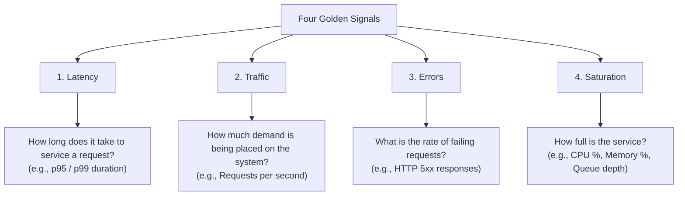
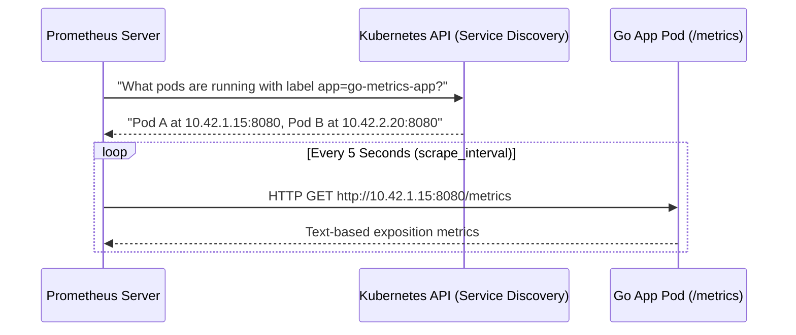

# 📘 Kubernetes Observability I: Monitoring, Prometheus & Grafana

Welcome to Day 9! Monitoring is the foundation of reliability engineering. If you can't measure your system in real time, you cannot guarantee its uptime, performance, or SLA.

---

## 1. The Core Concept: The 4 Golden Signals 🚦

According to the Google SRE Book, every production monitoring system should track the **Four Golden Signals**:



---

## 2. Metrics Server vs Prometheus: What's the Difference? 🔍

A common question among Kubernetes engineers: *"If we have Prometheus, why do we need Metrics Server (and vice versa)?"*

| Feature | **Metrics Server** | **Prometheus** |
| :--- | :--- | :--- |
| **Purpose** | Resource metrics for **Kubernetes autoscaling** (HPA, VPA) and `kubectl top`. | Full-stack application & infrastructure **monitoring, alerting & dashboarding**. |
| **Storage** | **In-memory only**. Keeps only the latest scrape value (last ~15-60 seconds). | **Time-Series Database (TSDB)** stored on persistent disk (days/months/years). |
| **Data Collected** | Basic CPU and Memory usage per Node and Pod from cAdvisor. | Everything: Custom app metrics, business KPIs, JVM/Go runtime, network, disk, ingress, etc. |
| **Query Language** | None (accessed via K8s API `metrics.k8s.io`). | **PromQL** (Extremely rich functional query language). |
| **Alerting** | None. | Native **Alertmanager** with Slack, PagerDuty, Email integrations. |

---

## 3. Pull vs Push Model: Why Prometheus Chose Pull 🧲

Unlike traditional agents that "push" metrics to a central server (e.g., StatsD, Datadog), Prometheus uses a **PULL architecture**:



### Why Pull is Superior for Cloud-Native Microservices:
1. **Centralized Rate Control**: The monitoring server controls the scrape rate. A traffic spike on your app will not flood your monitoring pipeline with metric packets.
2. **Built-in Health Checking**: If Prometheus fails to pull metrics from an endpoint, it immediately records `up == 0`. With push models, a dead service simply stops sending data (indistinguishable from a quiet network).
3. **No Target Configuration Needed**: Targets don't need to know where Prometheus lives. Prometheus discovers targets dynamically via the Kubernetes API.

---

## 4. The 4 Prometheus Metric Types 📊

Prometheus organizes all data into four core data structures:

### 1. Counter (Monotonically Increasing)
* **Behavior**: A number that can **only go up** (or resets to 0 when the process restarts).
* **Use Cases**: Total requests, total errors, bytes transferred, tasks completed.
* **Never query raw counters!** Always wrap counters in `rate()` or `increase()`.
* **Example**:
  ```promql
  # Calculates requests per second averaged over the last 5 minutes
  rate(http_requests_total[5m])
  ```

### 2. Gauge (Arbitrary Up and Down)
* **Behavior**: A number that can rise and fall at any moment.
* **Use Cases**: Current temperature, memory usage, CPU percentage, active connections, queue length.
* **Example**:
  ```promql
  http_active_requests
  ```

### 3. Histogram (Bucketed Observations)
* **Behavior**: Measures durations or sizes and sorts them into pre-defined buckets (`le` = less than or equal).
* **Auto-generated Metrics**:
  * `<name>_bucket{le="..."}`: Counter of observations in each bucket.
  * `<name>_sum`: Total sum of observed values.
  * `<name>_count`: Total number of observations.
* **Use Cases**: Request latency, response sizes.
* **Example: Calculating 95th Percentile Latency**:
  ```promql
  histogram_quantile(0.95, sum(rate(http_request_duration_seconds_bucket[5m])) by (le))
  ```

### 4. Summary (Client-side Quantiles)
* **Behavior**: Similar to Histogram, but quantiles (p50, p90, p99) are calculated directly on the client application rather than on the Prometheus server.
* **Limitation**: Summaries cannot be aggregated across multiple instances! Prefer **Histograms** in microservice architectures.

---

## 5. PromQL Quick Reference Cheat Sheet 📝

| Intent | PromQL Query |
| :--- | :--- |
| **Instant Request Rate** | `sum(rate(http_requests_total[1m]))` |
| **Error Rate %** | `(sum(rate(http_requests_total{status=~"5.."}[1m])) / sum(rate(http_requests_total[1m]))) * 100` |
| **Top 5 Memory Consumers** | `topk(5, container_memory_working_set_bytes)` |
| **p99 Latency (ms)** | `histogram_quantile(0.99, sum(rate(http_request_duration_seconds_bucket[5m])) by (le)) * 1000` |
| **Pod CPU Usage (Cores)** | `sum(rate(container_cpu_usage_seconds_total{container!=""}[1m])) by (pod)` |
| **Target Availability** | `up{job="go-metrics-app"}` |

---

## 6. The Danger of "High Cardinality" ⚠️

In Prometheus, every unique combination of metric name and label key-value pairs creates a **new time series** in memory and on disk.

```text
# GOOD (Low Cardinality: bounded set of values)
http_requests_total{method="GET", status="200", path="/api/work"}

# DANGEROUS (High Cardinality: unbounded explosion!)
http_requests_total{user_id="user_984124", email="john@gmail.com", transaction_id="tx_981249"}
```
> 🚨 **Rule of Thumb**: Never place dynamic IDs (User IDs, UUIDs, Timestamps, Email addresses, IP addresses) in Prometheus labels! This causes TSDB memory exhaustion. Keep labels bounded to known enums (HTTP methods, response codes, endpoints).
